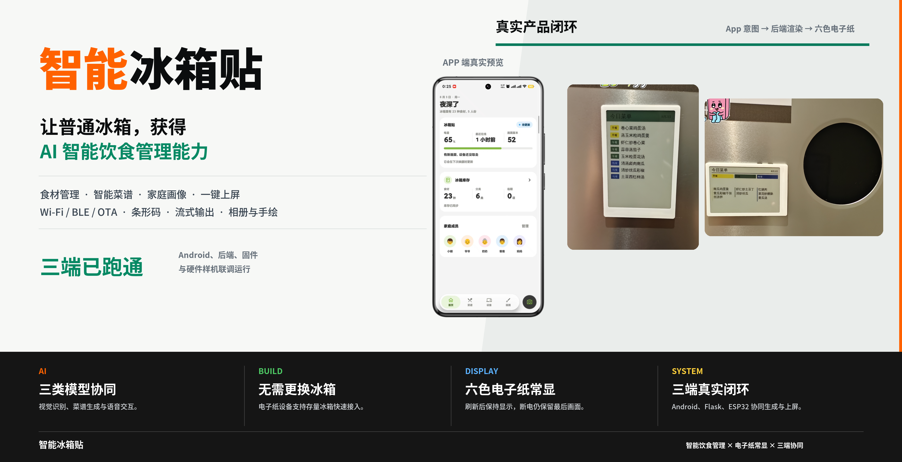

<p align="center">
  <a href="docs/assets/smart_fridge_magnet_icon.svg">
    
  </a>
</p>

<h1 align="center">智能冰箱贴</h1>

<p align="center">
  简体中文 | <a href="README.en.md">English</a>
</p>



智能冰箱贴是一个面向 `792 x 528` 六色电子纸屏幕的开源原型项目。Android App 负责食材
库存与设备设置，Flask 后端负责生成并渲染每日菜单，ESP32-S3 固件通过 HTTPS 下载后端
生成的 `.film` 文件并驱动电子纸显示。

> 本仓库是独立的开源项目，不隶属于任何公司或设备生态，也不代表任何公司或设备生态的
> 官方产品或背书。

## 系统架构

```text
Android App
  -> Flask API：库存、家庭画像、菜单生成、设备控制
  -> 后端渲染：792 x 528 图像 -> 209120 字节 .film 文件
  -> HTTPS manifest：一个版本包含今日、早餐、午餐、晚餐四张画面
  -> ESP32-S3 固件：下载、校验、持久化、显示、深睡
```

后端是 `.film` 编码的唯一实现。Android 预览直接解码后端产物，固件只处理文件和像素，
从而保证 App 预览与设备实际显示的是同一份字节。

## 核心能力

- 食材库存、保质期、家庭画像和每日菜单管理。
- 可配置兼容 [Chat Completions](https://platform.openai.com/docs/api-reference/chat)
  协议的文本、视觉和语音模型。
- 今日、早餐、午餐和晚餐四张画面的版本化整套发布。
- BLE 配网与兜底传输，以及 HTTPS 主同步链路。
- ESP32-S3 深睡、定时唤醒、本地缓存和 OTA。
- 无需构建的浏览器硬件与 BLE 调试工具。

## 仓库结构

```text
android/    Kotlin 与 Jetpack Compose App
backend/    Flask API、AI 接入、渲染、调度和测试
embedded/   ESP32-S3 固件与宿主机测试
hardware/   硬件快照与结构件模型
docs/       跨端契约与功耗模型
tools/      浏览器设备调试工具
```

## 快速开始

### 后端

建议使用 Python 3.13：

```bash
cd backend
python3 -m venv .venv
.venv/bin/pip install -r requirements.txt -r requirements-dev.txt
cp .env.example .env
.venv/bin/python scripts/setup_demo_data.py
.venv/bin/python -m src.app
```

在 `.env` 中配置 `AI_API_KEY`、`AI_BASE_URL` 和三个 `AI_MODEL_*` 模型标识。模型服务需要
兼容 Chat Completions 请求格式；本地开发默认监听 `127.0.0.1:5000`。鉴权、HTTPS、持久化
和部署方式见[后端说明](backend/README.md)。

仓库包含完整营养数据表 `backend/data/nutrition/china_food_composition.json`，可由项目维护者
按需导入 SQLite；请查看 [来源与署名](NOTICE.md) 并保留数据集说明。也可以运行
`backend/scripts/setup_demo_data.py` 生成少量合成演示数据。演示家庭成员和截图中的个人画像均为
合成示例，不代表真实家庭。

### Android

#### 环境要求

- [Android Studio](https://developer.android.com/studio)（推荐），或单独安装
  [Android SDK Command-Line Tools](https://developer.android.com/tools/sdkmanager)。
- JDK 17 或更高版本；项目已使用 OpenJDK 22 验证。`build-apk.sh` 会在构建前检查 Java 版本。
- 通过 Android Studio 的 SDK Manager 或 `sdkmanager` 安装：
  - Android SDK Platform 36（`platforms;android-36`；`targetSdk` 仍为 34）
  - Android SDK Build-Tools 36（`build-tools;36.0.0`）
  - Android SDK Platform-Tools（`platform-tools`，提供 `adb`）
- 首次构建需要访问 `google()`、`mavenCentral()` 和 Gradle 分发站点，以自动下载 AndroidX、
  Compose、OkHttp、Coil、ZXing 等依赖。

项目固定使用 Android Gradle Plugin `8.13.2`、Kotlin `2.3.21` 和 Gradle Wrapper `8.13`，
不需要安装系统级 Gradle。纯命令行环境可以这样配置：

```bash
export JAVA_HOME="/path/to/jdk-17-or-newer"
export ANDROID_HOME="$HOME/Android/Sdk"
export PATH="$JAVA_HOME/bin:$ANDROID_HOME/cmdline-tools/latest/bin:$ANDROID_HOME/platform-tools:$PATH"

sdkmanager --licenses
sdkmanager "platforms;android-36" "build-tools;36.0.0" "platform-tools"
```

如果 SDK 不在 `$ANDROID_HOME`，也可以创建不入 Git 的 `android/local.properties`：

```properties
sdk.dir=/absolute/path/to/Android/Sdk
```

环境就绪后执行：

```bash
cd android
./build-apk.sh
```

脚本默认构建 Debug APK；也支持 `./build-apk.sh release`、`./build-apk.sh debug -i` 和
`./build-apk.sh clean`。直接使用 Gradle 时可运行 `./gradlew testDebugUnitTest` 或
`./gradlew :app:assembleDebug`。详细说明见 [Android 开发文档](android/README.md)。

在 App 开发者选项中配置后端地址和 App Token。App 不保存模型服务密钥。

### 固件

安装 [ESP-IDF v6.0.2](https://docs.espressif.com/projects/esp-idf/en/v6.0.2/esp32s3/)，然后执行：

```bash
cd embedded/smart_fridge_magnet
bash test/host/run_host_tests.sh
idf.py set-target esp32s3
idf.py build
```

构建基线见[固件 BUILD](embedded/smart_fridge_magnet/BUILD.md)，本地 CA、烧录和运行机制见
[固件说明](embedded/README.md)，发布候选检查见[真机验证清单](embedded/VERIFICATION.md)。
编译成功不能替代电子纸刷新、BLE、Wi-Fi、唤醒和电流等真机验证。

### 浏览器调试工具

```bash
python3 -m http.server 8000 --directory tools/sfm-devtool
```

使用支持 [Web Bluetooth](https://developer.mozilla.org/en-US/docs/Web/API/Web_Bluetooth_API)
的浏览器打开 `http://localhost:8000`。

## 安全

- 禁止提交 `.env`、API Key、设备 Token、私钥、数据库、日志、生成的 `.film` 或构建产物。
- 部署前必须替换示例凭据；使用自签 HTTPS 时为该部署生成独立 CA，并只在本地固件构建中启用。
- 未配置鉴权和 HTTPS 时，后端应保持只监听回环地址。
- 安全问题按[安全策略](SECURITY.md)私下报告。

## 文档

- [跨端契约](docs/contracts/README.md)
- [后端 API](backend/docs/API.md)
- [BLE 协议](embedded/smart_fridge_magnet/docs/ble_protocol.md)
- [硬件来源与范围](hardware/README.md)
- [贡献指南](CONTRIBUTING.md)

## 致谢

感谢 [kirmisaki/FrameFilm](https://github.com/kirmisaki/FrameFilm) 项目及其贡献者公开
FrameFilm 的固件与硬件设计。本项目的部分 ESP32-S3 固件和硬件快照源自该项目，并在其
基础上适配智能冰箱贴的六色电子纸、Android、后端同步和低功耗工作流。

上游导入基线、硬件快照提交、许可证和本项目修改范围见
[来源与署名](NOTICE.md)及[固件上游说明](embedded/smart_fridge_magnet/NOTICE.md)。

## 许可证

本仓库采用 [GNU General Public License v3.0 or later](LICENSE)。仓库中源自上游项目的固件
和硬件资料继续保留其版权声明与 GPL 条款，具体归属见[来源与署名](NOTICE.md)。
